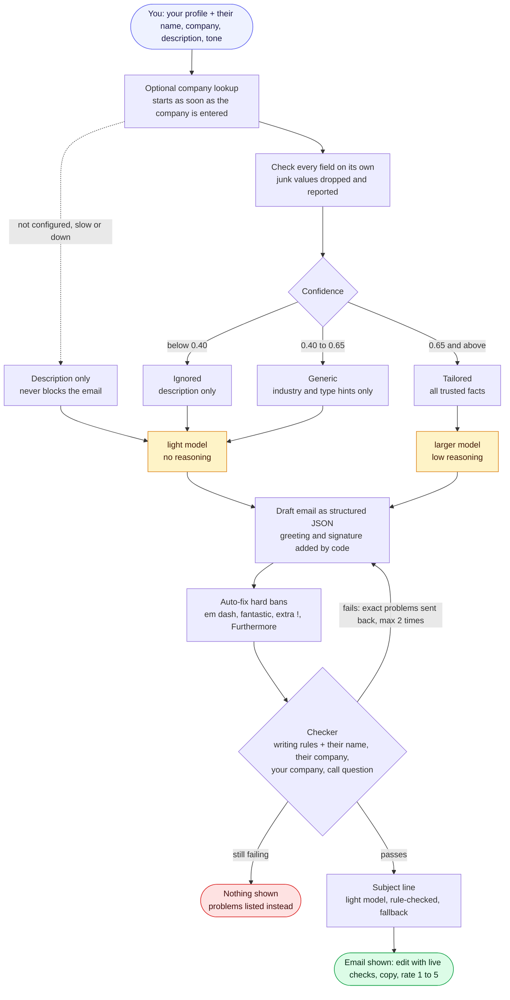

# Bob

Bob writes personalised cold outreach emails for anyone selling anything. Tell Bob who you are and what you offer once, then for each prospect give a name, a company, a line about them and a tone. Bob writes an email built around their likely problem, optionally tailors it with company data when that data is trustworthy, and **only shows an email once code has verified every writing rule**.

It runs as a CLI and as a small web app, both on one shared core.

## Quick start

Requires Node 20+.

```bash
git clone https://github.com/jamamv/raphie-personalized-outreach.git bob
cd bob
npm install
cp .env.example .env          # add your OPENAI_API_KEY (and optionally SENDER_*)
npm start                     # CLI: asks about you, then about them
npm run web                   # web UI at http://localhost:3000
npm test                      # unit tests, no network or key needed
```

### Tell Bob about you

Every email is written from your **sender profile**:

| Field | Example | Notes |
|---|---|---|
| Your name | Sam Taylor | Signs the email. |
| Your company | Fieldnote | Must appear in the email (checked). Signs the email under your name. |
| What you offer | Fieldnote records sales calls and writes the CRM notes and follow-up tasks automatically. | One or two sentences in your words. The only source Bob uses for what you do, so it never invents features. |
| Proof point (optional) | Reps at Hartley Freight save about 4 hours a week. | A real result or customer. Without one, Bob makes no claims about past results. |

In the web app these are the **About you** fields, remembered in your browser. For the CLI, set `SENDER_NAME`, `SENDER_COMPANY`, `SENDER_OFFER` and `SENDER_PROOF` in `.env`, pass `--from-name`, `--from-company`, `--offer`, `--proof`, or just answer the questions.

### CLI

```bash
npm start -- --name "Jane Doe" --company "Corvid Logistics" \
  --description "A freight brokerage whose sales team doubled this year" --tone direct
```

Flags skip the questions: `--name`, `--company`, `--description`, `--tone direct|warm`, the sender flags above, `--model`, `-v` (verbose), `--dry-run` (print the exact prompt without calling OpenAI).

The subject and email go to **stdout only if the email passed every rule**. Everything else goes to stderr, so `npm start > email.txt` gives a clean file. Exit codes: `0` ok, `1` error, `2` no draft passed the rules.

## What you get

* **Emails that follow the rules.** Every email shown passes all the writing rules, checked by code, and your edits in the web app are checked live by the same code.
* **A subject line** that matches the email, editable and rerollable on its own.
* **Visible reasoning:** the angle the email was built on, and "Why this email" listing every company fact used, withheld or dropped.
* **One-click copy**, regenerate, and undo for edits.
* **A 1 to 5 feedback score** with a comment, plus whether the email was copied and how much was edited (`npm run feedback` summarises it).

## How it works



| File | Job |
|---|---|
| `prompts/system.md` | Every instruction the model gets: how to use your profile, required content, writing rules, tone rules with examples. |
| `src/prompt.js` | Builds the `<data>` block (your profile, the prospect, lookup facts); adds greeting and signature. |
| `src/generator.js` | OpenAI Responses API call, sanitize, validate, repair loop. |
| `src/validator.js`, `src/sanitize.js` | The rules, in code. |
| `src/helper.js` | Optional company lookup client. Retries fast failures, waits on slow ones. Never throws. |
| `src/insights.js` | Confidence tiers, per-field checks, and the "why" report. |
| `src/subject.js`, `prompts/subject.md` | Subject line: a small separate call on the light model, rule-checked, with a fallback. |
| `src/core.js` | The shared pipeline used by the CLI and the web server. Writes `runs.jsonl`. |
| `src/cli.js`, `src/web/` | The two interfaces. `src/web/handlers.js` holds the API handlers used both locally and on Vercel. |
| `api/`, `vercel.json`, `scripts/build-web.js` | Vercel deployment. |
| `src/feedback.js` | Validates feedback scores and summarises them. |
| `scripts/eval.js`, `scripts/compare.js` | Live evaluation and run comparison. |

## The writing rules

The model is asked to follow the rules, but **code decides**.

| Rule | How it is enforced |
|---|---|
| No em dash (—), and no spaced en dash or ` -- ` stand-ins | Fixed in code (replaced with a comma). |
| No sentence starting with "Furthermore" or "Additionally" | Fixed in code (word removed). |
| No "fantastic" | Fixed in code. |
| At most one `!` | Fixed in code (extras become periods). |
| No two consecutive sentences starting with the same word | Checked; the model must rewrite. Greeting and signature lines count. |
| No sentence over 30 words | Checked; the model must rewrite. The prompt asks for 25 to leave headroom. |
| Their first name, their company, your company, a question asking for a call | Checked. |

Buzzwords (leverage, seamless, unlock...) produce a warning, not a failure.

Structural problems go back to the model with the offending sentences quoted, at most twice. If the email still fails, **nothing is shown as an email**: the CLI exits with code 2 and lists the problems, and the web page shows the problems instead of a draft.

**Subject lines** are written after the email passes, from the finished email, so they always match. Code checks them: 2 to 8 words, at most 60 characters, no exclamation marks, dashes, "fantastic", emojis, fake "Re:"/"Fwd:" or shouting in capitals (company names like "NVIDIA" are allowed). A failing subject is retried once, then replaced by "Idea for {company}", so it never blocks the email.

## Company lookup (optional)

Without a lookup, Bob writes from your description, which is often all a good cold email needs. To tailor emails with company data, point `HELPER_URL` at any enrichment endpoint (your own, or a small wrapper around a data provider) that follows this contract:

```
POST HELPER_URL   {"name": "Corvid Logistics"}
→ 200 {
    "confidence": 0.88,                         // 0 to 1, required for any use
    "industry": "logistics",                    // broad
    "companyType": "freight_brokerage",         // broad
    "operatingRegions": ["US", "MX"],           // country codes or EU, LATAM, APAC, EMEA...
    "painPoints": ["crm_data_entry", "rep_ramp_time"],
    "priorities": ["cross_border_expansion"],
    "technologies": ["salesforce"]
  }
```

Every field is optional. The lookup starts as soon as the company name is entered, so it overlaps your typing, and it never blocks the email: fast failures (429, 5xx) are retried up to 4 times, slow answers get up to 15s, all within `HELPER_BUDGET_MS` (20s).

| Confidence | Tier | What the model gets |
|---|---|---|
| below 0.40 | **ignored** | Nothing. Written from the description alone. |
| 0.40 to 0.65 | **generic** | Industry and company type hints only. The model describes what teams like theirs usually face, and states nothing as fact about this company. |
| 0.65 and above | **tailored** | All valid fields. Still framed as an outside view, never as inside knowledge. |
| not configured or failed | **none** | Same as ignored. |

**Why tiers.** A wrong specific claim hurts a cold email more than a vague one ("your US team" sent to a UK-only company ends the conversation), so the most specific fields need the most confidence. Lookup scores also tend to move between calls for the same company, so the lines should sit away from where your endpoint's real scores cluster. The defaults are a starting point; `runs.jsonl` logs every score so you can calibrate.

**Confidence is per response, but junk is per field.** Enrichment APIs return values like `"error: could not classify company"`, `"n/a"` or `"INTL"` even at high confidence. Every field must pass its own check (plain short labels, real region codes), and free text in lists is dropped, so the endpoint cannot inject instructions. Each decision shows under "Why this email".

**Your description always wins.** When the lookup disagrees with what you wrote, the model is told to follow you.

**"Beyond the description" is made explicit.** Code works out which lookup facts you did not already mention, and the prompt asks the model to build at least one point on the most specific of them. That is what makes the email look researched.

## Prompt design

- **Instructions and data are separate.** `prompts/system.md` holds every instruction, readable as a document. Your profile, the prospect and the lookup facts go in a `<data>` block the model is told to treat as information, never instructions.
- **Your offer is the only source of truth about you.** No invented features, customers, numbers or case studies; a proof point is used only if you give one.
- **Tone has rules plus a full example.** Direct leads with who you are and asks for a specific slot. Warm opens with one friendly line and makes a soft ask with no time slot. The examples use fictional companies in two different industries, and the model is told not to reuse their wording.
- **Structured output.** The model returns `{angle, helperFactsUsed, paragraphs}`. Code adds "Hi {first name}," and your signature, so those can never be wrong, and the chosen angle is visible for checking.
- **Model routing.** Emails with trusted lookup facts use `gpt-5.5` with low reasoning (weaving in specific facts is where reasoning pays off); everything else, and every subject line, uses `gpt-5.4-mini` without reasoning, which is many times cheaper. Override with `OPENAI_MODEL`, `OPENAI_LIGHT_MODEL` and their `_REASONING_EFFORT` variables, or `--model`. The fixed instructions come first in every request with a `prompt_cache_key`, so OpenAI's prompt cache serves most input tokens.

## Web UI

- **About you** sits at the top of the form, is remembered in your browser and folds away once filled in. **Clear** empties the prospect, not your profile.
- **The company lookup starts when you leave the company field** (if one is configured), and the page shows what was found before you generate.
- **The email is editable**, with the same `validator.js` the server uses checking edits live, so you can't unknowingly add an em dash (macOS turns `--` into one) or a 31-word sentence. Copy still works, labelled "Copy anyway", because you have the final say.
- **A stateless API.** `/api/lookup` returns the lookup result and the page passes it back to `/api/generate`, so the lookup is called once and the same code runs as serverless functions. Passed-back data goes through the same field checks as a live response. Empty sender fields in API calls fall back to `SENDER_*`.

## Evaluation

`npm run eval -- --reps 2` runs 7 fixed scenarios against the live OpenAI API, with **recorded** lookup responses so the model is the only variable: a tailoring A/B (the same payload at confidence 0.88 and 0.21), a lookup outage with a proof point, junk values at 0.99, a middle-confidence case, a lookup that contradicts the description, and a low-confidence misclassification. It reports rule passes (first try and after repair), whether lookup-only facts appear when trusted and stay out when not, phrases copied from the prompt, buzzwords, stock phrases shared across companies, tokens and cost. Results are saved to `eval/results/`; `npm run compare -- <label> <label>` puts runs side by side.

## Deploy to Vercel

1. On [vercel.com](https://vercel.com), choose **Add New → Project** and import this repo. Leave the framework preset as **Other**; `vercel.json` sets the build.
2. Under **Environment Variables**, add `OPENAI_API_KEY`, and `ACCESS_CODE` (strongly recommended: without it, anyone with the URL can spend your OpenAI credit). Add `HELPER_URL` if you have a lookup.
3. Click **Deploy**.

On Vercel the disk is temporary, so runs and feedback are written to the **Logs** tab instead (one JSON line each).

## Configuration

All optional except the key (see `.env.example`): `OPENAI_API_KEY`, `SENDER_NAME`, `SENDER_COMPANY`, `SENDER_OFFER`, `SENDER_PROOF`, `HELPER_URL` (unset: no lookup), `HELPER_BUDGET_MS` (20000), `OPENAI_MODEL` / `OPENAI_REASONING_EFFORT` (`gpt-5.5`, `low`), `OPENAI_LIGHT_MODEL` / `OPENAI_LIGHT_REASONING_EFFORT` (`gpt-5.4-mini`, `none`), `MAX_REPAIRS` (2), `RUN_LOG` (`runs.jsonl`), `FEEDBACK_LOG` (`feedback.jsonl`), `ACCESS_CODE`, `PORT` (3000).

Every run appends one line to `runs.jsonl` (gitignored) with inputs, the raw lookup response, tier, model, angle, whether it passed, and the email. It contains names, so treat it as personal data; set `RUN_LOG=off` to disable it.

## Scripts

| Command | Description |
|---|---|
| `npm start` | CLI: asks the questions, prints the subject and email |
| `npm run web` | Web UI at http://localhost:3000 |
| `npm test` | Unit tests (no network or API key) |
| `npm run eval` | Live eval against OpenAI (`--model`, `--effort`, `--reps`, `--label`, `--only`) |
| `npm run compare` | Compare saved eval runs side by side, including cost |
| `npm run feedback` | Summary of feedback scores |

## What's next

- **Batch mode** from a CSV of prospects, using the same core.
- **Website research**: read the prospect's homepage or recent news as an extra, clearly sourced fact.
- **Multiple profiles**, for people who sell more than one product.
- **Follow-up sequences**: 2 or 3 short follow-ups that each add something new, stopping on a reply or opt-out.
- **Send from your own mailbox** (Gmail or Outlook), with a do-not-contact check, an opt-out line and daily limits.
- **Learn from replies**: record each email's outcome by `runId` and compare reply rates by tone, tier, model and subject.
